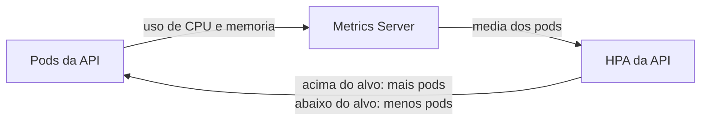

# ADR-016: Escalabilidade das APIs com HPA

**Status**: Aceita

**Resumo**:
Cada uma das 5 APIs tem um **HPA** (Horizontal Pod Autoscaler): uma regra do Kubernetes que aumenta ou diminui a quantidade de cópias (pods) da API conforme o uso de CPU e memória, de 1 a 10 pods. A quantidade de máquinas (nós) do cluster não muda: são sempre 2.

> As ADRs são numeradas em sequência única entre os quatro repositórios do projeto. O índice de todas as decisões está no [docs/arquitetura.md](https://github.com/GuiToniello/tech-challenge-fase-3-APP-soat16-rm374658/blob/main/docs/arquitetura.md#5-decisões-de-arquitetura-rfcs-e-adrs) do repo APP.

**Contexto**:
- As 5 APIs (monolith, approval, createos, getos e status) rodam no Amazon EKS, cada uma em um Deployment que começa com 1 pod.
- Cada pod **reserva** 100m de CPU (um décimo de um núcleo) e 128Mi de memória (o *request*) e pode **usar no máximo** 500m de CPU e 512Mi de memória (o *limit*).
- A carga muda ao longo do dia, e cada API recebe um tipo de pedido. É preciso aguentar picos sem deixar pods sobrando no resto do tempo.
- O cluster é pequeno e tem custo fixo: 2 nós `t3.small` (mínimo, desejado e máximo iguais a 2), com espaço para 22 pods e cerca de 1,4 GiB de memória livre para pods em cada nó ([k8s/README.md](../../k8s/README.md#61-capacidade-do-cluster), seção 6.1).
- O requisito do projeto para o autoscaling é: CPU-alvo de 30%, mínimo de 1 e máximo de 10 réplicas ([k8s/README.md](../../k8s/README.md#6-regras-de-hpa-aplicadas), seção 6).

**Decisão**:

1. **Um HPA por API** (`autoscaling/v2`), nos arquivos `k8s/features/<api>-api/hpa.yml`, todos com as mesmas regras:
   - mínimo de 1 e máximo de 10 pods;
   - CPU-alvo de 30% do request, ou seja, 30m por pod, em média;
   - memória-alvo de 150% do request, ou seja, 192Mi por pod, em média. O alvo era 80% e subiu porque o tracer do Datadog aumenta a memória de cada pod ([ADR-014](https://github.com/GuiToniello/tech-challenge-fase-3-APP-soat16-rm374658/blob/main/docs/adr/ADR-014-Observabilidade-com-Datadog.md)).
2. **As medições vêm do Metrics Server**, instalado por Terraform em `infra/addons` ([metrics-server.tf](../../infra/addons/metrics-server.tf)).
3. **Escala horizontal:** o HPA cria mais pods iguais, em vez de deixar cada pod maior. Isso funciona porque as APIs não guardam dados na memória entre um pedido e outro: tudo fica no PostgreSQL. Assim, qualquer pod atende qualquer pedido, e o Service do Kubernetes divide os pedidos entre eles.
4. **Nós fixos:** o cluster não cria máquinas novas sozinho (sem Cluster Autoscaler ou Karpenter). O node group fica em 2 nós para o custo não crescer sem controle.

Como o HPA decide, em poucas palavras:

- A cada 15 segundos, o HPA compara o uso médio dos pods com o alvo.
- Se a média passa do alvo, ele calcula quantos pods trariam o uso de volta ao alvo e cria os que faltam, até 10. Exemplo: 1 pod usando 60m de CPU está no dobro do alvo (30m), então o HPA sobe para 2 pods.
- Quando o uso cai, ele remove pods aos poucos, depois de 5 minutos de calma, até voltar a 1.
- Com duas métricas, vale a que pedir mais pods.

**Consequências**:
- ✅ Cada API cresce sozinha quando recebe mais pedidos e volta a 1 pod quando a carga passa, sem ação manual.
- ✅ As APIs escalam de forma independente: um pico de consultas na getos-api não cria pods das outras APIs.
- ✅ Custo previsível: como os nós são fixos, o HPA só usa o espaço que já existe no cluster.
- ⚠ **O limite real é o espaço nos 2 nós, não o máximo de 10.** Juntas, as 5 APIs poderiam pedir até 50 pods, mas o cluster comporta 22 pods no total e, em uso normal, já roda 15 (as 5 APIs, o Datadog e os pods do próprio Kubernetes). Pods além da capacidade ficam `Pending` (esperando espaço). A saída prevista é trocar os nós por `t3.medium` ([k8s/README.md](../../k8s/README.md#61-capacidade-do-cluster), seção 6.1).
- ⚠ **CPU-alvo baixo (30%):** o HPA escala cedo. Responde rápido aos picos, mas pode criar pods com pouca carga.
- ⚠ **Memória como métrica:** a memória de uma API .NET demora a cair depois de um pico e pode segurar pods a mais por um tempo. Se o HPA escalar sem carga, a orientação é deixar só a CPU ([k8s/README.md](../../k8s/README.md#6-regras-de-hpa-aplicadas), seção 6).
- ⚠ **Escalar não é instantâneo:** um pod novo precisa baixar a imagem, iniciar a API e passar no teste de saúde (`/health`) antes de receber pedidos.
- ⚠ **Depende do Metrics Server:** sem ele, o HPA fica sem medições e para de escalar (os pods atuais continuam rodando).

**Alternativas Rejeitadas**:
- Quantidade fixa de pods, sem autoscaling:
  - rejeitada porque sobra recurso fora dos picos e falta nos picos.
- VPA (Vertical Pod Autoscaler), que aumenta o tamanho de cada pod em vez da quantidade:
  - rejeitada porque precisa recriar os pods para mudar o tamanho, não ajuda em picos rápidos e exigiria instalar mais componentes no cluster.
- Cluster Autoscaler ou Karpenter, que criam e removem nós:
  - rejeitada para manter o custo fixo e previsível num projeto de estudo.
- KEDA, que escala por eventos (como o tamanho de uma fila):
  - rejeitada porque o sistema não tem filas nem eventos para medir ([ADR-015](https://github.com/GuiToniello/tech-challenge-fase-3-APP-soat16-rm374658/blob/main/docs/adr/ADR-015-Comunicacao-Sincrona-via-API-Gateway.md)).
- Métricas personalizadas, como pedidos por segundo vindos do Datadog:
  - rejeitada porque exigiria um adaptador de métricas no cluster; CPU e memória bastam para o escopo.

**Relação com Outras ADRs**:
- **ADR-014** (repo APP): o tracer do Datadog levou o alvo de memória de 80% para 150% e reduziu a folga do cluster.
- **ADR-015** (repo APP): a comunicação síncrona, sem filas e com as APIs sem estado, é o que permite escalar só criando mais pods.
- **RFC-001** (este repo): a escolha da AWS e dos nós `t3.small` define a capacidade do cluster ([RFC-001](../rfc/RFC-001-Escolha-da-Nuvem.md)).
